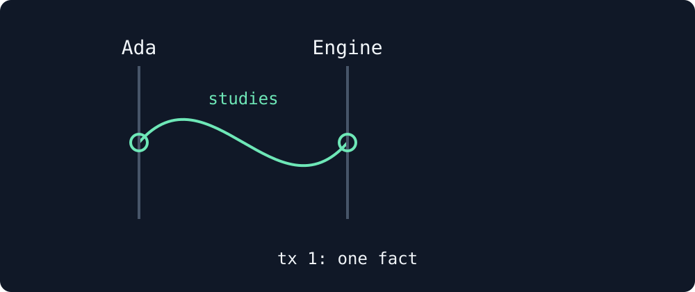
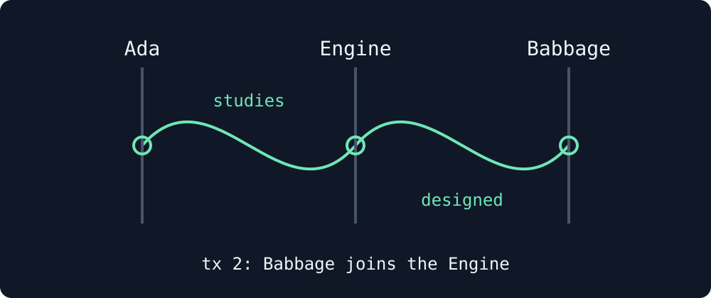
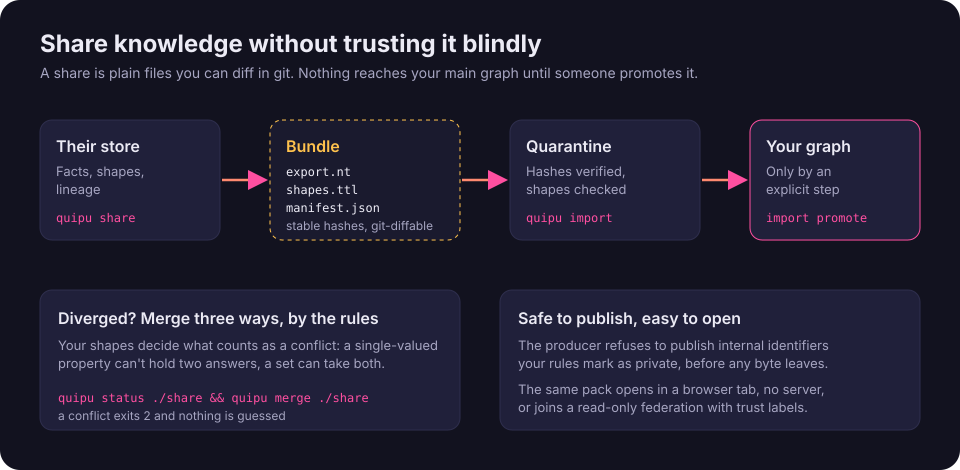

<p align="center">
  
</p>

<h1 align="center">Quipu</h1>
<p align="center"><em>Governed knowledge your agents can read, reuse and share</em></p>
<!-- badges:start (scripts/check-readme-badges.py fails CI if this row or the DOI/arXiv links go missing) -->
<p align="center">
  <a href="LICENSE"></a>
  <a href="https://github.com/intigraph/quipu/actions/workflows/ci.yml"></a>
  <a href="https://crates.io/crates/quipu-ai"></a>
  <a href="https://intigraph.github.io/quipu/"></a>
  <a href="https://doi.org/10.5281/zenodo.21878428"></a>
  <a href="https://arxiv.org/abs/2608.16813"></a>
  <a href="https://github.com/intigraph/tambo"></a>
</p>
<!-- badges:end -->
<p align="center"><strong><a href="https://intigraph.github.io/quipu/">Read the book →</a></strong></p>

**Quipu is a governed, bitemporal knowledge store for AI agents and the
people who run them.** Use it from the command line, REST, MCP or a Rust application.

## Why you would want it

- **Governed:** check incoming knowledge against your vocabulary and shapes.
- **Bitemporal:** keep a queryable history of facts and decisions.
- **Reusable agent knowledge:** store memory agents can read, reuse and share across tools.
- **Time-aware entities:** attach event-triggering time attributes for [Chaski](https://github.com/intigraph/chaski) to react to.

Use Quipu as the **central graph and base for many tools**: see [the stack](#-the-stack).
The full case is in [Why Quipu](https://intigraph.github.io/quipu/why-quipu.html).

<p align="center">
  
</p>

## Install

```sh
curl -fsSL https://raw.githubusercontent.com/intigraph/quipu/main/install.sh | sh
```

Linux and macOS, x86_64 and arm64; requires Python 3.9+ and curl.
The installer verifies the published archive checksum and executable version.
Then run `quipu --version`. [Install, upgrade or remove Quipu](https://intigraph.github.io/quipu/getting-started/installation.html).
For the whole stack, use [Tambo's guided onboarding](https://github.com/intigraph/tambo).

## First success: insert a fact, watch the graph change

Write one fact in plain Turtle, knot it into a local store, and ask for it back:

```sh
printf '@prefix : <urn:demo:> .\n:Ada :studies :Engine .\n' > ada.ttl
quipu knot ada.ttl --db demo.db
quipu read 'SELECT ?who ?what WHERE { ?who <urn:demo:studies> ?what }' --db demo.db
```

Add a second fact and the graph grows. The first version is still there to query:

```sh
printf '@prefix : <urn:demo:> .\n:Babbage :designed :Engine .\n' > babbage.ttl
quipu knot babbage.ttl --db demo.db
quipu read 'SELECT ?s ?p ?o WHERE { ?s ?p ?o }' --db demo.db
quipu read 'SELECT ?s ?p ?o WHERE { ?s ?p ?o }' --tx 1 --db demo.db
```



<table>
<tr><th>After the first fact</th><th>After the second fact</th></tr>
<tr>
<td></td>
<td></td>
</tr>
</table>

[Transcript, tool version and reproducible capture](docs/demos/terminal.md).

## On your own code

Keep project facts, decisions and relationships together instead of pasting the same context into each agent.

| You want to | Start here |
|---|---|
| Load facts and apply your vocabulary | [Quick Start](https://intigraph.github.io/quipu/getting-started/quick-start.html) |
| Ask about current or historical knowledge | [SPARQL and time](https://intigraph.github.io/quipu/concepts/temporal-model.html) |
| Share a governed knowledge bundle | [Verified sharing](https://intigraph.github.io/quipu/sharing/index.html) |
| Prepare domain knowledge and shapes | [Camayoc](https://github.com/intigraph/camayoc) |

<p align="center">
  
</p>

The [latest release](https://github.com/intigraph/quipu/releases/latest) includes a repository pendant,
checksum and provenance. Verify them together, then use `quipu import SHARE_DIR --db repository.db`;
import stages knowledge and leaves ROOT unchanged. Follow the [verified import workflow](https://intigraph.github.io/quipu/sharing/index.html).

## Wire it into your agent

For Claude Code, connect the local MCP server to your database:

```sh
claude mcp add quipu -- quipu mcp --db /path/to/knowledge.db
```

The MCP Registry identifier is `mcp-name: io.github.intigraph/quipu`.
Other clients, HTTP MCP and credential configuration: [Agent Setup](https://intigraph.github.io/quipu/getting-started/agent-setup.html).
Use [Tambo](https://github.com/intigraph/tambo) to configure and verify the tools together.

## Before you start

- The CLI runs locally; `quipu-server` supplies the network API and explorer.
- Fresh stores support keyword search without downloading a model. `quipu search "your terms"` uses keyword search until an embedding provider is configured; explicit `--mode semantic` still requires a model and vectors. Install the pinned default model with `quipu model install` in a full build. Check readiness with `quipu doctor search`.
- [Configuration](https://intigraph.github.io/quipu/getting-started/configuration.html) covers storage and server settings.

## What's next

- [The Quipu book](https://intigraph.github.io/quipu/): tutorials, concepts and references.
- [Quick Start](https://intigraph.github.io/quipu/getting-started/quick-start.html): governed local examples.
- [Domain shapes](https://intigraph.github.io/quipu/concepts/domain-shapes.html): producer-owned vocabulary.
- [Stack README format](https://github.com/intigraph/tambo/blob/main/docs/stack/README-TEMPLATE.md) and [shared hero theme](assets/readme-theme.md).

## 🧺 The stack

Tambo installs these together and proves each one works; every tool also stands alone.
Use each tool's README for its own installation and first success.

<!-- stack-table:start -->

The Quipu stack is built around a governed, bitemporal knowledge store: shared
facts, decisions and work history your agents can query. Quipu can check writes
against your rules, records where each fact came from, and answers what was true
when.

| tool | what it gives your agents |
|---|---|
| [tambo](https://github.com/intigraph/tambo) | 🧰 Agent Platform Toolkit - installs and configures the quipu stack |
| [quipu](https://github.com/scbrown/quipu) | stores shared facts with provenance and history; can check writes against your rules |
| [camayoc](https://github.com/scbrown/camayoc) | prepares knowledge and vocabulary for Quipu, with checks before it is admitted |
| [quechua](https://github.com/scbrown/quechua) | shared vocabulary and shapes for interoperable knowledge |
| [chaski](https://github.com/scbrown/chaski) | reacts to graph changes and delivers governed notifications |
| [bobbin](https://github.com/scbrown/bobbin) | indexes your codebase and injects context from that index and Quipu knowledge |
| [yupana](https://github.com/scbrown/yupana) | shows code impact and can read policies from Quipu to govern agent actions |
| [desire-path](https://github.com/scbrown/desire-path) | turns agent mistakes into feature requests; works on its own without Quipu |
| [seeds](https://github.com/scbrown/seeds) | a work item tracker backed by the Quipu knowledge base |
| [shantytown](https://github.com/scbrown/shantytown) | runs crews of AI agents on work items, triggered by hand, on a schedule or by events; can share work and memory through Quipu |
| [rikuy](https://github.com/scbrown/rikuy) | live brief: status, graphs, watches and signed decisions over Quipu |
| [shuttle](https://github.com/scbrown/shuttle) | runs signed agent workflows and keeps their records in Quipu |

<!-- stack-table:end -->

## Contributing

See [CONTRIBUTING.md](CONTRIBUTING.md). The repository's checks are:

```sh
just check
just docs check
```

## 📜 License

[Apache-2.0](LICENSE).
