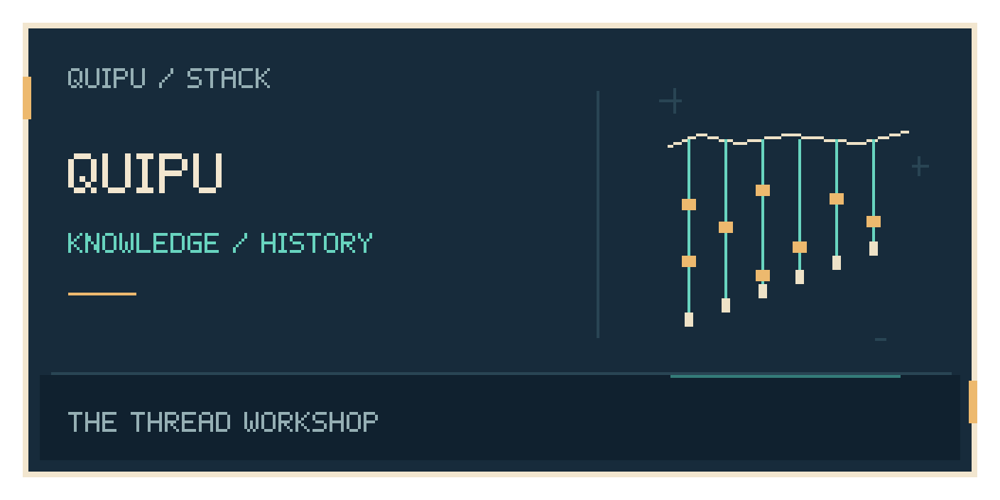
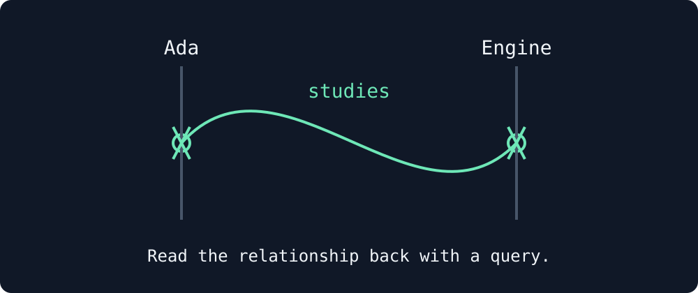
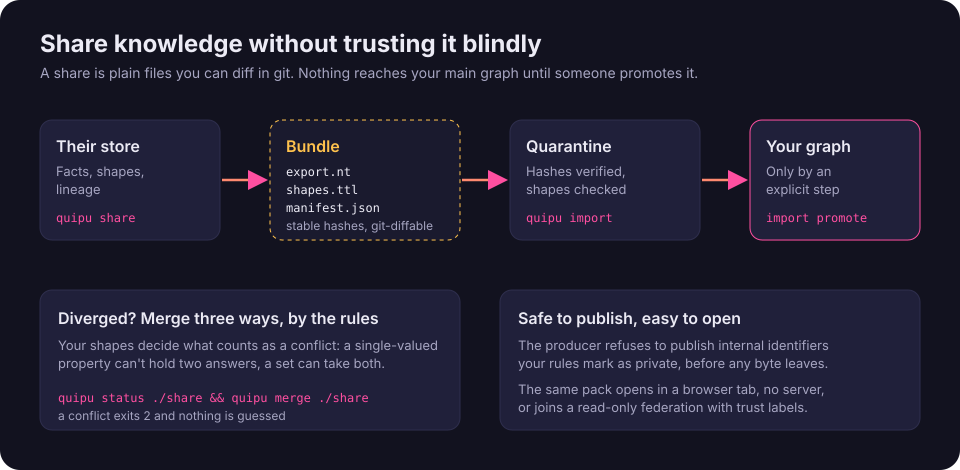
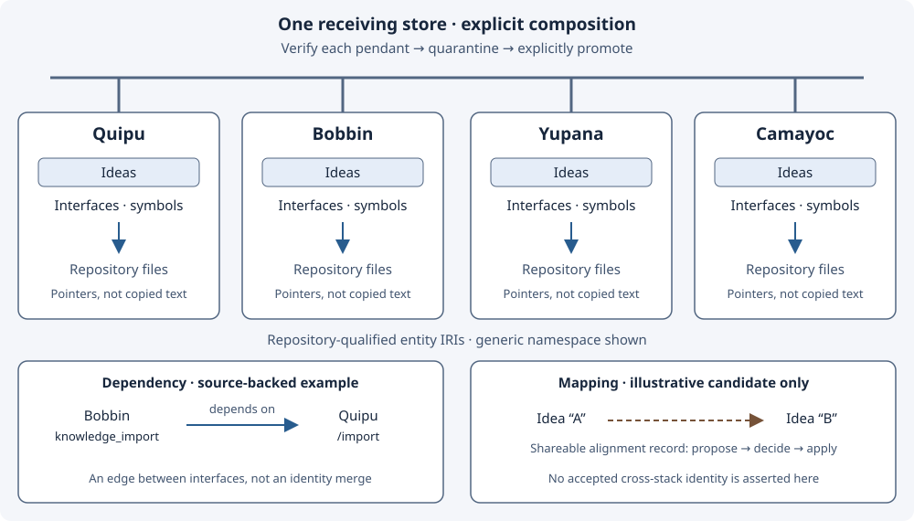

<p align="center">
  
</p>

<p align="center">
  
</p>

<h1 align="center">Quipu</h1>
<p align="center"><em>Governed knowledge your agents can read, reuse and share</em></p>
<p align="center">
  <a href="LICENSE">Apache-2.0</a> ·
  <a href="https://github.com/intigraph/quipu/actions/workflows/ci.yml">CI</a> ·
  <a href="https://intigraph.github.io/quipu/">Read the book</a>
</p>

**Quipu is a governed, bitemporal knowledge store for AI agents and the people
who run them.** Use it from the command line, REST, MCP or a Rust application.
A quipu is an Andean knotted-cord record: cords are entities, knots are facts.

## Why you would want it

- **Governed:** check incoming knowledge against your vocabulary and shapes.
- **Bitemporal:** keep a queryable history of facts and decisions.
- **Reusable agent knowledge:** store memory agents can read, reuse and share across tools.
- **Time-aware entities:** attach event-triggering time attributes for [Chaski](https://github.com/intigraph/chaski) to react to.

Use Quipu as the **central graph and base for many tools**: see [the stack](#-the-stack).
The full case is in [Why Quipu](https://intigraph.github.io/quipu/why-quipu.html).

<p align="center">
  
</p>

## Install

```sh
curl -fsSL https://raw.githubusercontent.com/intigraph/quipu/main/install.sh | sh
```

Linux and macOS, x86_64 and arm64; requires Python 3.9+ and curl.
The installer verifies the published archive checksum and executable version.
Then run `quipu --version`. [Install, upgrade or remove Quipu](https://intigraph.github.io/quipu/getting-started/installation.html).
For the whole stack, use [Tambo's guided onboarding](https://github.com/intigraph/tambo).

## First success in three commands

In an empty directory, fetch the public fixture, store its episode, then ask about its relationship:

```sh
curl -fsSL https://raw.githubusercontent.com/intigraph/quipu/main/docs/demos/terminal/fixture/episode.json -o episode.json
quipu episode episode.json --base-ns urn:demo: --timestamp 2026-01-01T00:00:00Z --db demo.db
quipu read 'SELECT ?person ?thing WHERE { ?person <urn:demo:studies> ?thing }' --db demo.db
```

The query returns **Ada → Engine**. Here is the real local episode and query:



The resulting row, drawn as cords and knots:



The recording uses a local public fixture, without a server or model. Its native
warning is retained: loading facts is not proof that a semantic index is ready.
[Transcript, tool version and reproducible capture](docs/demos/terminal.md).

## On your own code

Keep project facts, decisions and relationships together instead of pasting the same context into each agent.

| You want to | Start here |
|---|---|
| Load facts and apply your vocabulary | [Quick Start](https://intigraph.github.io/quipu/getting-started/quick-start.html) |
| Ask about current or historical knowledge | [SPARQL and time](https://intigraph.github.io/quipu/concepts/temporal-model.html) |
| Share a governed knowledge bundle | [Verified sharing](https://intigraph.github.io/quipu/sharing/index.html) |
| Prepare domain knowledge and shapes | [Camayoc](https://github.com/intigraph/camayoc) |

<p align="center">
  
</p>

### Repository knowledge



The [latest release](https://github.com/intigraph/quipu/releases/latest) includes a repository pendant,
checksum and provenance. Verify them together, then use `quipu import SHARE_DIR --db repository.db`;
import stages knowledge and leaves ROOT unchanged. Follow the [verified import workflow](https://intigraph.github.io/quipu/sharing/index.html).

<!-- delivery-catalog:start -->

## Delivery events

Bring deployment outcomes and change history into the same governed memory.
These adapters use CDEvents on CloudEvents and Camayoc's single ingress.

[Catalog data](https://github.com/intigraph/camayoc/blob/main/catalog/delivery-emitters.json) · [Updating the table](https://github.com/intigraph/camayoc/blob/main/catalog/README.md)

| Tool | Standard | How | Status | Docs |
| --- | --- | --- | --- | --- |
| GitHub / Forgejo Actions | CDEvents on CloudEvents | Reusable deployment-event action or CLI; skipped and cancelled jobs emit no deployment. | Supported adapter; activation is separate | [Guide](https://github.com/intigraph/camayoc/blob/main/actions/deployment-event/README.md) |
| Ansible | CDEvents on CloudEvents | Callback writes one event per applied host; failed or unreachable recap counters mean failure. | Supported adapter; activation is separate | [Guide](https://github.com/intigraph/camayoc/blob/main/emitters/ansible/README.md) |
| Terraform | CDEvents on CloudEvents | Wrap an actual apply -json; errors or a nonzero exit after an attempted change mean failure. | Supported adapter; activation is separate | [Guide](https://github.com/intigraph/camayoc/blob/main/emitters/terraform/README.md) |
| Native CDEvents | CDEvents on CloudEvents | Pass supported CDEvents through the single governed ingress; unknown types are quarantined. | Supported adapter; activation is separate | [Guide](https://github.com/intigraph/camayoc/blob/main/docs/design/ingress.md) |
| GitHub change lifecycle | CDEvents on CloudEvents | Read change, CI and native review records into ChangeEvent history; scheduling is separate. | Supported adapter; activation is separate | [Guide](https://github.com/intigraph/camayoc/blob/main/emitters/github/changes.py) |

The catalog describes source support, not installed producers or measured event coverage.
The graph queries for deployment frequency, change failure rate, lead time and restore time
need recorded events for the selected service, repository and time window.
Missing change or deployment history is not a measured zero.

<!-- catalog-source-sha256: ea2627bd96ba33263f3c3cc89dd0e64cfbb14788f6a14411df92448ec48aef14 -->
<!-- delivery-catalog:end -->

## Wire it into your agent

For Claude Code, connect the local MCP server to your database:

```sh
claude mcp add quipu -- quipu mcp --db /path/to/knowledge.db
```

The MCP Registry identifier is `mcp-name: io.github.intigraph/quipu`.
Other clients, HTTP MCP and credential configuration: [Agent Setup](https://github.com/intigraph/quipu/blob/main/docs/book/src/getting-started/agent-setup.md).
Use [Tambo](https://github.com/intigraph/tambo) to configure and verify the tools together.

## Before you start

- The CLI runs locally; `quipu-server` supplies the network API and explorer.
- Keep your database and credentials private. A demo fixture is not a deployment profile.
- Semantic search needs a configured model and index; storing a graph alone does not provide either.
- [Configuration](https://intigraph.github.io/quipu/getting-started/configuration.html) covers storage and server settings.

## What's next

- [The Quipu book](https://intigraph.github.io/quipu/): tutorials, concepts and references.
- [Quick Start](https://intigraph.github.io/quipu/getting-started/quick-start.html): governed local examples.
- [Domain shapes](https://intigraph.github.io/quipu/concepts/domain-shapes.html): producer-owned vocabulary.
- [Stack README format](https://github.com/intigraph/tambo/blob/main/docs/stack/README-TEMPLATE.md) and [shared hero theme](assets/readme-theme.md).

## 🧺 The stack

Tambo installs these together and proves each one works; every tool also stands alone.
Use each tool's README for its own installation and first success.

<!-- stack-table:start -->

The Quipu stack is built around a governed, bitemporal knowledge store: shared
facts, decisions and work history your agents can query. Quipu can check writes
against your rules, records where each fact came from, and answers what was true
when.

| tool | what it gives your agents |
|---|---|
| [tambo](https://github.com/intigraph/tambo) | 🧰 Agent Platform Toolkit - installs and configures the quipu stack |
| [quipu](https://github.com/scbrown/quipu) | stores shared facts with provenance and history; can check writes against your rules |
| [camayoc](https://github.com/scbrown/camayoc) | prepares knowledge and vocabulary for Quipu, with checks before it is admitted |
| [quechua](https://github.com/scbrown/quechua) | shared vocabulary and shapes for interoperable knowledge |
| [chaski](https://github.com/scbrown/chaski) | reacts to graph changes and delivers governed notifications |
| [bobbin](https://github.com/scbrown/bobbin) | indexes your codebase and injects context from that index and Quipu knowledge |
| [yupana](https://github.com/scbrown/yupana) | shows code impact and can read policies from Quipu to govern agent actions |
| [desire-path](https://github.com/scbrown/desire-path) | turns agent mistakes into feature requests; works on its own without Quipu |
| [seeds](https://github.com/scbrown/seeds) | a work item tracker backed by the Quipu knowledge base |
| [shantytown](https://github.com/scbrown/shantytown) | runs crews of AI agents on work items, triggered by hand, on a schedule or by events; can share work and memory through Quipu |
| [rikuy](https://github.com/scbrown/rikuy) | live brief: status, graphs, watches and signed decisions over Quipu |
| [shuttle](https://github.com/scbrown/shuttle) | runs signed agent workflows and keeps their records in Quipu |

<!-- stack-table:end -->

## Contributing

See [CONTRIBUTING.md](CONTRIBUTING.md). The repository's checks are:

```sh
just check
just docs check
```

## 📜 License

[Apache-2.0](LICENSE).
