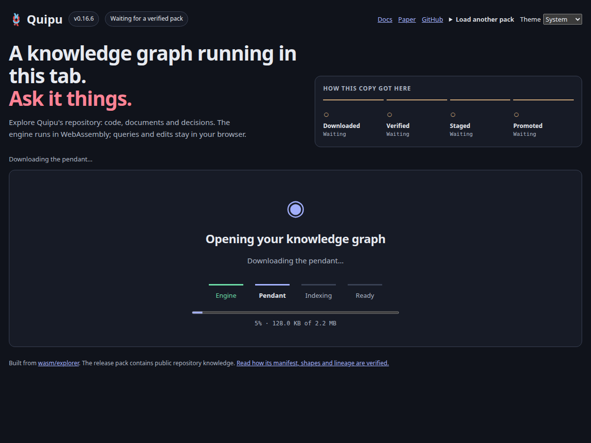
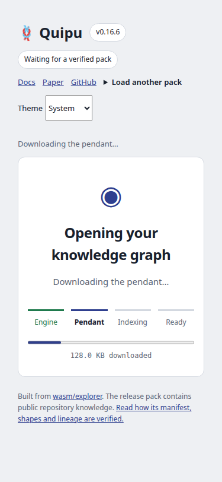

# Explore loading: before and after

[Before recording](before.webm) · [After recording](after.webm)

Open the page with a cold browser context. The baseline shows a small status
line above an empty work area; the candidate shows Engine → Pendant → Indexing
→ Ready, including a percentage from actual transferred bytes. Both finish
with a successful query against the imported graph.

Baseline source: `cf03e657b39ca284633285c070c3d83969ff336a`.
The PR body pins the candidate revision containing this recording; the
[SHA-256 manifest](source-sha256.txt) identifies the tested source bytes.
Both use the released Quipu 0.16.6 WASM engine
(`ad8de357521acdbd9f7a0175a37b7c20d3a21f5c`) and its repository pendant.
This is source-checkout browser evidence, not a claim that Pages is deployed.

The recording uses Playwright Chromium with a 1.6-second engine response delay
and real pendant bytes streamed in 128 KiB chunks every 100 milliseconds.
The worker, verification, import, indexing and queries run normally. Videos
retain the continuous run and are re-encoded at 8 fps, 960 × 720, for size.
Download a WebM to replay it if the repository viewer does not play it inline.

Reproduce after staging the released assets and installing the project's
Playwright test tool:

```sh
just explorer release
just explorer-loading
```

The script also checks unknown response sizes, mobile layout, reduced motion,
failed downloads, worker startup failures, damaged pendants and repeated loads.
It fails unless recovery reaches a real positive query; manual state changes
or mock worker replies are not used.




