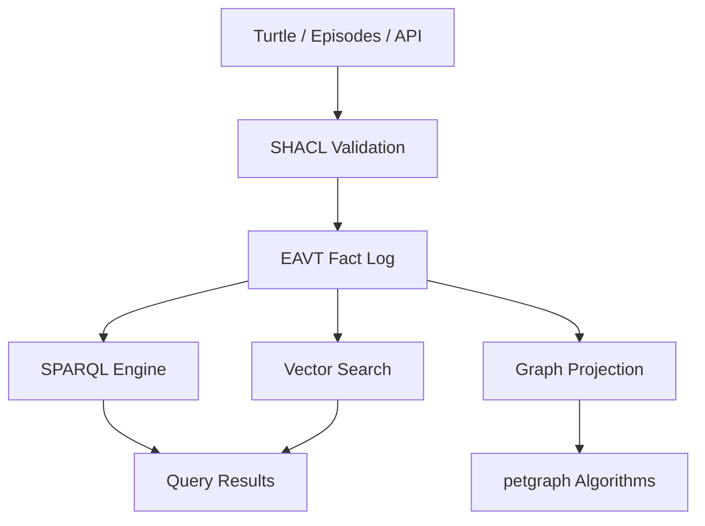

# Quipu

The Quipu stack is built around a governed, bitemporal knowledge store: shared
facts, decisions and work history your agents can query. Quipu can check writes
against your rules, records where each fact came from, and answers what was true
when.

**Quipu is that store.** *Bitemporal* means keeping both when a fact was recorded
and, when supplied, when it was true.

A [quipu](https://en.wikipedia.org/wiki/Quipu) is the Andean knotted-cord record:
cords are entities, knots are facts.

## See it

**[Datalinks — a 3D explorer, live in your browser](datalinks/)**, over Alpha
Centauri's technology tree: 374 entities, 329 prerequisite edges, 17 ranks.
Height is longest-path depth, so position is derived and stable rather than
emergent. Select a node and the lattice re-lights by personalized PageRank
seeded on it. No server — the graph is a baked Quipu export.

**[Explore this repository's graph](explore/)** — Quipu's own code and docs as a
knowledge graph, 61k triples shipped with every release, imported and queried
**by Quipu itself compiled to WebAssembly**. The pack is verified against its
manifest, its shapes are adopted, and it is staged and promoted in your tab
before you can query it: the receiving half of the sharing story below, running
rather than described. Then edit it — add, change and retract facts through the real
write path — and export the result as a pack that
`quipu import <archive> --db your.db` stages against your local shapes. Still no
server.

## What is Quipu?

An embeddable Rust library and server for building knowledge graphs with:

- **Immutable bitemporal fact log** — time-travel, contradiction detection,
  full audit trail
- **RDF data model** — IRIs, blank nodes, typed literals via oxrdf
- **SPARQL 1.1 query engine** — SELECT, CONSTRUCT, ASK, DESCRIBE with
  property paths, aggregates, RDFS inference
- **SHACL validation** — configurable write checks with structured,
  agent-friendly feedback
- **Hybrid search** — SPARQL + vector similarity in a single query
- **Episode ingestion** — structured write path for agent-extracted knowledge
- **Bulk import + promote** — load or migrate a whole dataset validated in a
  staging graph, then admit it in one transaction ([guide](recipes/bulk-loads.md))
- **Graph projection** — materialize subgraphs into petgraph for centrality,
  components, shortest-path algorithms
- **"SQLite energy"** — single process, no server required

## Ways to Use It

Choose how your application or agent connects to the graph:

| Surface | Use case | Start here |
|---------|----------|------------|
| **Rust crate** (`quipu-ai`) | Embed the store and query engine in a Rust application | [Rust API](reference/api.md) |
| **CLI** (`quipu`, alias `qp`) | Query and manage a local database from a terminal or script | [CLI reference](reference/cli.md) |
| **REST API** (`quipu-server`) | Access a shared store through Quipu's HTTP endpoints | [REST reference](reference/rest-api.md) |
| **Server web UI** | Explore the running server's graph and use its SPARQL workbench in a browser | [Web UI tour](why-quipu.md#rest-api--web-ui) |
| **SPARQL protocol** | Use standard query and update HTTP transports with a SPARQL client | [Query and update](reference/rest-api.md#get-query-and-post-query) |
| **MCP over stdio** (`quipu mcp --db <path>`) | Connect an agent to a local store through the sibling server | [Local MCP setup](getting-started/agent-setup.md#local-stdio-mcp) |
| **MCP over HTTP** (`quipu-server` at `/mcp`) | Connect agents to a running server using streamable HTTP | [HTTP MCP setup](getting-started/agent-setup.md#connect-to-an-http-server) |
| **Browser WebAssembly** | Run the engine in a browser, explore and edit a graph, and exchange verified pendants | [Browser explorer](explore/) |
| **Node.js WebAssembly** | Load the released headless engine without a browser | [Node release usage](https://github.com/intigraph/quipu/blob/quipu-ai-v0.16.6/.github/workflows/release.yml#L363-L412), [query builders](reference/query-builder.md#javascript-and-wasm) |
| **Local Python library** (`quipu-kg`, `import quipu`) | Run the engine in-process; build the wheel from source | [Local Python engine](reference/python-client.md#local-python-engine) |
| **Python REST client** (`quipu_client`) | Call a running server from Python with no runtime dependencies | [Python client](reference/python-client.md) |
| **Query-first agent skill** (`skills/quipu`) | Give a coding agent instructions for consulting an existing graph | [Agent setup and skills](getting-started/agent-setup.md) |
| **Embedded-artifacts agent skill** (`skills/quipu-embedded-artifacts`) | Build graph-backed pages using the released Wasm engine | [Artifact skill](https://github.com/intigraph/quipu/blob/quipu-ai-v0.16.6/skills/quipu-embedded-artifacts/SKILL.md) |

These surfaces are present in [release 0.16.6](https://github.com/intigraph/quipu/releases/tag/quipu-ai-v0.16.6):
native binaries and browser/Node Wasm are release assets; the Python packages
and skills are included in the [tagged source](https://github.com/intigraph/quipu/tree/quipu-ai-v0.16.6).
The local Python wheel is **not published on PyPI** and implements a subset of
the engine's operations. Skills supply instructions, not another server or
model. The [MCP reference](reference/mcp-tools.md) describes the available tools.

Local CLI, Rust and Python use can open a single-file store without a server;
the Wasm engine also runs locally. Storing facts and running SPARQL need no
model. Semantic search additionally needs a configured embedding provider and
index; see [configuration](getting-started/configuration.md).
For declared IRI namespaces and `quipu namespaces list|apply`, see
[Stable Entity References](reference/namespaces.md).

## Who Is This For?

This book is organized around four personas — pick the one that fits you:

| Persona | You want to... | Start here |
|---------|----------------|------------|
| **Homelab Operator** | Model hosts, services, and dependencies | [Tutorial](tutorials/homelab-operator.md) |
| **AI Agent Builder** | Let agents share structured knowledge | [Tutorial](tutorials/agent-builder.md) |
| **Code Archaeologist** | Understand how a codebase evolved | [Tutorial](tutorials/code-archaeologist.md) |
| **Knowledge Gardener** | Curate and validate an ontology | [Tutorial](tutorials/knowledge-gardener.md) |

New to SPARQL? Start with [SPARQL from Zero](tutorials/sparql.md) — it builds up
from a single triple to aggregates and temporal queries using concrete examples.

## Quick Taste

```bash
# Load some facts
quipu knot data.ttl --db my.db

# Query with SPARQL
quipu read "SELECT ?name WHERE { ?s <http://example.org/name> ?name }" --db my.db

# Start the server
quipu-server --db my.db --bind 0.0.0.0:3030

# Query over HTTP
curl -s localhost:3030/query -X POST \
  -H "Content-Type: application/json" \
  -d '{"query": "SELECT ?s ?p ?o WHERE { ?s ?p ?o } LIMIT 5"}'
```

## Architecture at a Glance



Facts enter through validation, land in the immutable log, and are queryable
through SPARQL, vector similarity, or graph algorithms. Every fact has a
transaction timestamp and an optional valid-time window — you can always
time-travel to see the state at any point.
