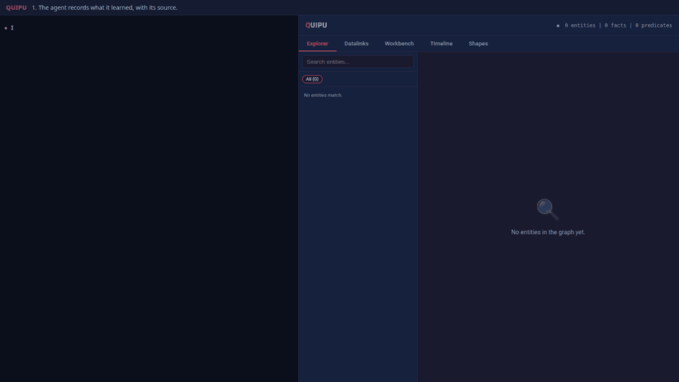

# An agent and its graph



The demo turns write checking on (it passes `--shapes` to every write). A scripted agent records what it learns about a small, fictional shop stack. On the left
is its terminal; on the right is Quipu's own explorer (`/ui`), served from the same store.
Every command shown is really run against a fresh local store, and every output is the
real output. The narration is scripted so the recording can be reproduced each release.

1. **Learn.** The agent records four services and their dependencies, each citing a trace
   or the service catalogue. They appear in the graph.
2. **Refuse.** It guesses that a cache sits in front of `orders`, with no source. The
   [shape](scenario/shapes.ttl) requires `sourceKind` and `prov:wasDerivedFrom`, so the
   write is refused: the graph does not change.
3. **Correct.** Citing a trace, the same claim is accepted and the node appears.
4. **Change.** `orders-db` moves from `db-a` to `db-b`: the old host is retracted (`qp retract`
   has no valid-time argument, so `db-a` ends at the moment of retraction) and `db-b` is
   recorded as valid from January 3.
5. **Ask the past.** `--valid-at 2026-01-02` answers `db-a`; the current read answers `db-b`.

The data are illustrative fixtures under `https://example.org/shop/`. No server outside
the recording, no credentials and no real hosts are involved.

## Re-record it

Needs Node 18+, Chrome or Chromium, Python 3 with Pillow, and a Quipu build
(`quipu` and `quipu-server`, for example from `cargo build --release --features shacl,onnx,owl,server`).

```bash
cd docs/demos/agent-graph
npm install
node record.mjs <dir-with-quipu-binaries> out      # CHROME=/path/to/chrome to override
python3 make-gif.py out/frames agent-graph.gif 960
```

`record.mjs` refuses to finish if the guess in step 2 is accepted, so a recording can never
show a refusal that did not happen. `out/` also holds the full-resolution WebM.
