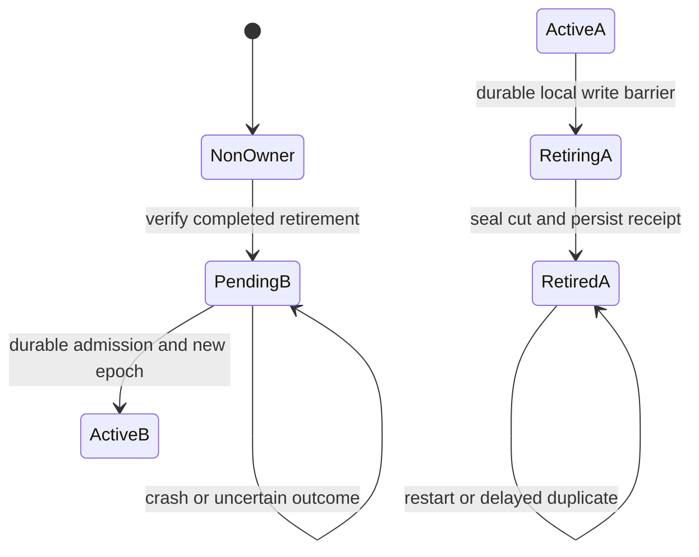

# Explicit source retirement and ownership handoff

Status: proposed source design. The controller selected explicit retirement,
not distributed lease failover. This document grants no implementation,
installation, adoption, retirement or production activation authority.

## Ground and scope

The retained two-host native fixture at source
`ed79bf881ec99e100d7fe3b047cb08d315bbdb59` demonstrated all of the following:

- Host B refuses an owned copy before explicit adoption; adoption and restore
  mint distinct epochs bound to B's real host and canonical path.
- A previously unowned copy remains writable and explicitly `INACTIVE`.
- A writer already open on B refuses its commit after only its binding's host
  changes to the real foreign host identifier; restoring the binding permits
  a positive write. The refused fact remains absent.
- A writer already open on the untouched original Host A **commits after B's
  adoption**, under A's unchanged epoch. Destination adoption does not revoke A.

These are disposable-fixture results, not installed acceptance. The actual
failed old-A fencing control is the before evidence; do not replace it with
another simulated provider test. Host identifiers, private paths and stores
are deliberately omitted here. The authority code remains unchanged at the
document's source base, `11f11593759af43c6ca6f0dffbb7f18e2c182a3e`.

[Current ownership](store-ownership.md) is a local placement guard. Its
[native binding](../../src/store/ownership.rs),
[commit fence](../../src/store/ownership_fence.rs) and
[release cleanup](../../src/store/release.rs) are useful seams, not a remote
fencing protocol. Existing restore deliberately preserves its source.
The [composition control](../../src/replicate_source_ownership_tests.rs)
proves rebootstrap and no splicing across epochs, not one surviving owner.

The first ownership unit is a complete logical store. A scoped replica cannot
be promoted. Independent graph owners from the proposed
[per-graph design](per-graph-writable-stores.md) need separately registered,
nonoverlapping authority units; this document does not create graph routing or
make a multi-file handoff atomic.

## Identity and invariant

`store_id` identifies a logical lineage; a copied file is not a new owner.
Authority is a versioned tuple containing that lineage, its exact authority
unit, generation, log epoch, admitted owner principal, native placement digest,
policy revision and the preceding retirement-certificate digest. A generation
orders ownership changes, an epoch names a log incarnation, and transaction IDs
remain local to that epoch. Neither a host ID nor a larger epoch is authority.

For each enrolled lineage/unit, **at most one admitted owner may commit
authoritative facts**. Zero owners during a failed handoff is safe. Ordinary
handles at one admitted placement serialize through its existing SQLite writer;
the invariant is one authority, not one operating-system process.

A non-owner may retain a read-only canonical base and separate local intents.
Those writes are not canonical commits, coverage, source transaction IDs or
proof of ownership. They use the [merge-back contract](#offline-work-and-merge-back).
They cannot be advertised as a canonical stream for the inherited lineage.

This guarantee is conditional on admitted binaries and the protected authority
state. It does not cover a privileged operator forging identities/keys, deleting
both authority records, or modifying SQLite through an uninstrumented program.
Those actions cannot be prevented by an application-level signature protocol.

## Alternatives and decision

| Approach | Safety and availability | Disposition |
| --- | --- | --- |
| New epoch plus host/path sidecar | Stops local misplaced copies; cannot stop untouched A | Retain as placement evidence only |
| Registry assignment without A retiring | Offline A can keep writing with its old grant | Reject as a handoff mechanism |
| Expiring leases checked at every commit | Can support failover only with a defined authority, expiry, skew and restart contract; partitions stop owners | Not selected; no lease or clock-based takeover now |
| Signed source retirement, destination-bound receipt and durable consumption | B cannot own until A's local commit boundary has been durably closed; offline A prevents a new handoff | Select Option A |

A signature authenticates an assertion; it does not stop an offline writer.
The source-side retirement barrier supplies that property. A small external
chain-head witness is proposed below for rollback detection, **not** permission
to assign a replacement while A remains active. No coordinator is provisioned
by this proposal.

## Durable authority and rollback limits

Each enrolled owner needs a protected per-lineage authority journal outside
the database, sidecar and transferable backup. It records the greatest admitted
generation, role, transfer ID, predecessor and consumed receipt. Missing,
unreadable, contradictory or incomplete enrolled state is `UNKNOWN`, never
legacy compatibility. A restored old database cannot erase retirement.

Ordinary files and fsync provide crash durability, not protection against a
whole-host rollback that restores the journal too. Such a rollback cannot be
detected from identical local bytes. Before an enrolled writer process starts,
it therefore needs a fresh nonce-bound admission against a durable chain-head
witness outside the transferred/restored unit, using an already admitted
authority identity. The witness must serialize predecessor checks and retain
the maximum generation; its own rollback is outside the supported fault model.
This is a proposed control-plane prerequisite, not a shipped endpoint or new
trust root. If no approved witness/profile is available, enrolled owner startup
is unavailable. Offline canonical restart must fail closed.

The witness may advance a handoff only with A's completed retirement certificate;
it cannot remotely supersede an active A. Once admitted, a running A can continue
offline using its protected local journal: no other owner can be admitted without
A participating in retirement. No per-commit network RPC or expiring lease is
selected. A witness outage blocks new admission/handoff, not a still-active
owner's already admitted local commits. Local journal loss blocks those commits.

The executable model makes the witness's intermediate states explicit: reserve
the exact request before the local barrier, then record completed source
retirement externally **before exposing a usable receipt**. Startup responses
bind this phase/reservation as well as the tuple and nonce. An unresolved
reservation blocks an ordinary source process restart; its exact retirement can
resume through the bounded internal transition path. An already admitted running
A remains writable until the actual local barrier. Without these distinctions,
old source host/journal bytes could restart A after receipt publication but before
the witness names B. These are candidate model/schema requirements, not a
provisioned witness or activated startup protocol.

Full host/journal/witness rollback, cloned native identities, and pre-fencing
binaries are not certified safe. Recovery must retain read-only/non-owner mode
until current external authority is reconciled. Deployment must prevent a
pre-fencing binary from mounting an enrolled unit writable; reverting source
alone cannot undo retirement or make an old epoch authoritative again.

## States and handoff

There is deliberately no timeout edge from `NonOwner` to `ActiveB`, nor an
automatic edge from `RetiringA` back to `ActiveA`. A's retirement is irreversible
within this handoff. Returning ownership requires another admitted handoff from
the current owner, not clearing a marker or reusing an abandoned generation.

### 1. Prepare without transferring authority

B presents an authenticated request bound to the expected current tuple, full
scope, operation ID, request digest, destination principal and native placement.
Only already admitted principals and signing/verifier profiles may participate.
If destination placement or verifier distribution is unavailable, refuse.
Possessing a stream-signing key does not grant ownership-transition authority.
Recheck the operator and destination's current grants at retirement and again
at destination admission; a signed receipt is not a permanent permission grant.
Preparation permits an inspected copy or non-owner fork; it grants no writes
into the canonical base and no ownership-authorized stream.

The source checks current operator/write authority and the complete request.
Changed payload under an operation ID refuses; an ambiguous outcome requires
exact readback. Two concurrent prepares cannot reserve the same successor for
different destinations. Numeric generations must not wrap or be reused.

### 2. Retire A at its actual commit boundary

Acquire the exclusive per-lineage admission latch. Wait for or refuse bounded
existing commits, then durably record `RETIRING(g, transfer, destination)` in
the protected journal. This is the point after which ordinary A commits refuse,
including handles opened before the transfer. No B receipt exists yet.

Seal the last accepted fact cut under that barrier. In a data-store transaction,
persist its retirement record, immutable cut digest, terminal epoch/control
record and receipt-outbox payload. Commit and sync it before the journal can
advance to `RETIRED`. A crash before either resource is complete leaves A fenced
and B unadmitted. Only an identical operation may resume after inspecting both.

After both records are durable and agree, finalize the source-signed receipt
and witness predecessor update. The outbox must not release a usable receipt
before the retirement barrier is durable. Signing early and merely promising
to retire later is forbidden. Lost replies return the same receipt, not another
epoch or another destination. Retired A can serve explicit historical evidence
and terminal control through a separate bounded path, not new canonical commits.

### 3. Admit B once, or remain a non-owner

B verifies the completed retirement, exact full snapshot/cut, trust and policy,
destination binding, generation chain and unused transfer ID. The receipt binds
protocol/domain version, lineage/unit, predecessor generation/epoch, successor
generation, transfer ID, operation/request digest, destination principal and
placement, sealed cut/artifact digest and signer/key/policy revision. It has no
wall-clock expiry that can create a new owner. A timestamp is audit data only.

B first persists `PENDING` in its protected authority journal. Install and verify
the database retirement proof, fresh destination epoch and native binding, then
persist `ACTIVE` only when all records agree. An interrupted sidecar replacement,
restore, fsync or journal commit cannot report activation or permit ordinary
writes. Receipt consumption and the activation result are durable and idempotent.
Exact retries return that result; a different digest or destination refuses.

If A is offline and cannot complete retirement, B remains a non-owner fork.
A previously completed, destination-bound retirement may be recovered only as
that same pending handoff, with current chain-head admission; it is not evidence
of a new offline takeover. A and the witness being unreachable is `UNKNOWN`.
When B is active, A remains retired even if B crashes before acknowledging it.

## Atomic write and stream enforcement

The effective role is the agreement of the protected journal, data-store marker,
native binding and handle's expected tuple. Never trust a cached open-time
`ACTIVE` result, a SQLite snapshot of an earlier generation, or one file alone.
The [SQLite commit hook](https://www.sqlite.org/c3ref/commit_hook.html) must not
run SQL on its committing connection; keep the separate reader. That reader
must end its read transaction between checks because
[WAL snapshots retain earlier state](https://www.sqlite.org/isolation.html).

All public write entrypoints acquire a per-lineage shared admission token before
their outer write scope and hold it through commit. Retirement takes the exclusive
token. A direct SQL writer still meets the commit hook: it must try the same
shared admission **without blocking**, verify current state through the existing
fresh reader, and abort on contention or uncertainty. This avoids deadlock when
retirement holds the exclusive latch while waiting for SQLite's writer lock.
The internal retirement transaction has a narrowly scoped transition token;
it cannot authorize unrelated fact writes or be passed to normal callers.

Audit every transaction/autocommit/outermost `RELEASE`, batches, attestation,
schema, fork/share promotion, imports, event/bookkeeping writers and maintenance.
Use the shared rollback-on-refused-release helper: no reported successful write
may remain in a doomed transaction. A lock/reader/inode/journal failure refuses.
Lock identity, lock ordering and cross-resource crash recovery must be proved
on each admitted native platform before activation, not inferred from a mutex.

Source and relay session admission, every bounded emission and freshness answer
must recheck authority. A captured `OwnershipState` alone is insufficient.
Retirement ends open sessions with signed, unfiltered `epoch_end` naming the
last accepted cut and retirement proof; no new freshness claim follows it.
Already in-flight historical frames do not grant current authority. Consumers
must pin lineage/generation/epoch, reject stale or reordered authority proofs,
and rebootstrap B instead of splicing B into A's cursor. This requires an
authority-aware versioned wire/profile change, not just a new sidecar field.

## Offline work and merge-back

Non-owners keep canonical base, overlay/intents and immutable base journal
separate. Local intent IDs/transaction IDs are never issued as canonical source
coordinates. Preserve origin principal, operation/delta digest, graph scope,
base generation/epoch/cut, valid-time data and signing evidence when available.
Unauthenticated proposals remain explicitly untrusted; storage is not admission.
The first implementation uses a separate local intent store with its own local
identity. Do not punch an overlay-write exception through the canonical store's
commit fence or reuse its inherited `store_id` for an intent feed.

Submission follows [local sync merge-back](local-sync-mode.md#7-overlay-and-merge-back)
and [changeset envelopes](changeset-format.md), not two-way `fork_promote`.
The current owner checks signature/replay/current graph authority, reconstructs
and verifies the base, performs three-way merge and complete-candidate validation,
then commits facts and an idempotent receipt in one fenced transaction.

Old A records that arrive after retirement are not replayed as canonical commits.
Preserve their original bytes and provenance as rejected/quarantined evidence.
They may become explicit intent candidates only after attribution and review;
do not silently rewrite them into legitimate offline proposals. A stale epoch
or unavailable base refuses with the overlay intact. Rebase creates a new
operation ID and envelope, retaining the superseded record. Conflicts produce
decisions; no silent acceptance, discard, retarget or partial apply.

## Failure contract

| Condition | Required result |
| --- | --- |
| Partition before A's retirement | A remains owner; B can record intents, cannot own |
| A retires, response is lost | A stays fenced; B waits or retrieves the same receipt |
| A crashes after barrier but before sealed receipt | No owner admitted at B; recover the identical operation, never blind re-adopt |
| B crashes during install or before activation acknowledgment | PENDING refuses, or the exact durable activation receipt is returned; A stays retired |
| Concurrent B/C requests | One predecessor CAS and one destination-bound receipt win; loser stays non-owner |
| Delayed/reordered/replayed fence | Verify generation, predecessor, destination and consumed ID; no backward transition |
| Clock skew, rollback or wall-clock expiry | No takeover transition; these clocks cannot grant ownership |
| Old DB/sidecar restored, journal current | Generation/retirement mismatch refuses, including held writers |
| Entire host/authority restored or witness unavailable on startup | No offline owner admission; reconcile externally or remain non-owner |
| Unknown signer/profile, policy or native identity | UNKNOWN/refusal, never another backend or inactive fallback for an enrolled lineage |

## Compatibility and acceptance boundary

Existing `store adopt/restore` establishes only the shipped local placement
capability. It must not automatically enroll a lineage or become a remote-owner
grant. The future authority mode and wire profile require explicit enrollment,
writer inventory and consumer admission. An enrolled lineage cannot downgrade
through a default constructor, missing sidecar, old backup or legacy mode.
Unenrolled legacy behavior remains explicitly INACTIVE and compatible, without
an authoritative-owner assertion. Older consumers that accept legacy sessions
are outside the new invariant until migrated; do not claim universal enforcement.

Native host identity is placement evidence, not a new trust root. Reuse only
already admitted signing/authority profiles; shared verifier distribution and
consumer gates remain prerequisites. OCI host/mount authority and browser
physical-host ownership remain unsupported. Non-owner browser/offline intent
work is not proof of an owned capability.

The [phased plan](ownership-handoff-plan.md) identifies source owners, tests and
rollout gates. A merged document, B's new epoch, or a local negative control does
not close the original acceptance. That needs the real retained-writer fixture
to reject A after explicit retirement, correct B admission, unchanged stale
followers, restart/rollback negatives and qualified consumer behavior under a
separately admitted same-source runtime scope.
